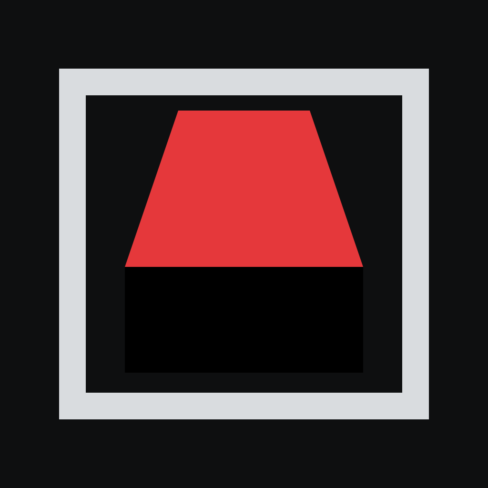
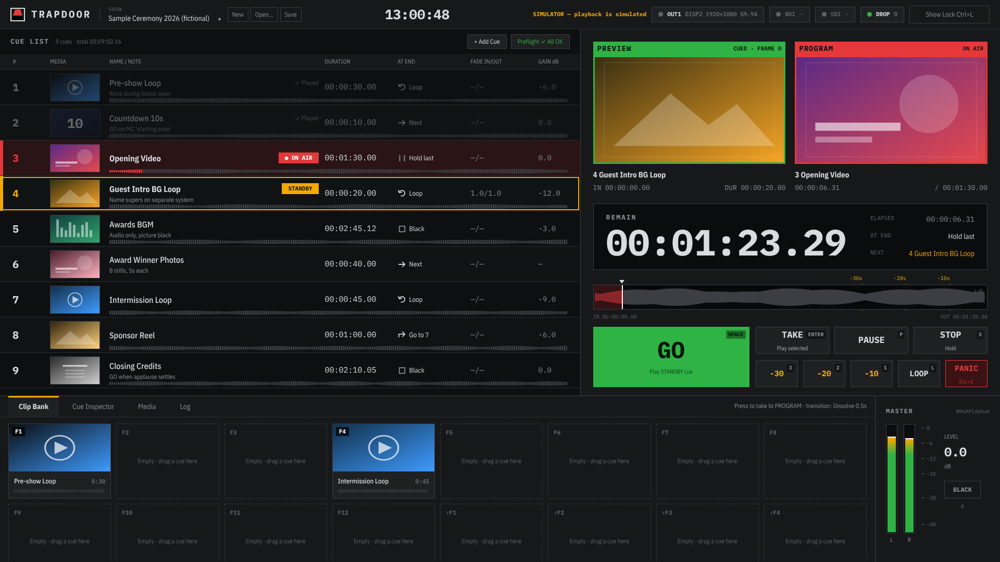

<p align="center">
  
</p>
<h1 align="center">TRAPDOOR</h1>
<p align="center">Video cue playout for live events — cue list, clip bank, PREVIEW / PROGRAM, one Windows PC.</p>



TRAPDOOR takes the parts operators rely on in Mitti, PVP3 and broadcast clip servers
and puts them on one screen:

- **Cue list** — GO with Space; per-cue start (play / pause at first frame) and end
  (black / hold last / next / loop ×N / go to cue); fades; PANIC (Esc ×2); jump to −30/−20/−10 s.
- **A/B decks** — the STANDBY cue is already decoded and parked on its first frame, so GO is a cut, not a load.
- **Clip bank** — 16 buttons on F1–F12 and Shift+F1–F4, fired without moving the running order.
- **Waveforms** everywhere: scrub bar, every cue row, every bank button.
- **Non-destructive adjustments** per cue: gain, loudness normalisation (LUFS), channel map, pan,
  fit / scale / position / crop, opacity, flip, brightness / contrast / saturation, speed.
- **Output** up to 8K (presets or custom raster, max 8192 × 4320) placed pixel-for-pixel on any display.
- **Remote control** — OSC (UDP 53000) and HTTP (port 8780) for Bitfocus Companion, Stream Deck, show control.
- **Show lock**, preflight (missing / failed media, frame-rate mismatch), autosave, relink by relative path.

The UI is English by default; Japanese is available in Output settings → Language.

## Download

Windows x64 builds are on the [Releases](../../releases) page:

- `TRAPDOOR-x.y.z-windows-x64-setup.exe` — installer
- `TRAPDOOR-x.y.z-windows-x64-portable.zip` — unzip and run `TRAPDOOR.exe`

## Keys

| Key | Action |
|---|---|
| Space | GO (play the STANDBY cue; a second GO releases a cue paused at its first frame) |
| Enter | TAKE the selected cue now |
| ↑ / ↓ | Move STANDBY |
| P | Pause / resume |
| Esc ×2 | PANIC (fade out to black in 1 s) |
| S (hold 0.5 s) | STOP (cut to black) |
| 1 / 2 / 3 | Jump to 10 / 20 / 30 s remaining |
| L | Toggle loop |
| B | Output black |
| F1–F12, Shift+F1–F4 | Clip bank |
| Ctrl+L / Ctrl+S / Ctrl+O | Lock / Save / Open |

## Remote control

OSC to UDP 53000 (feedback goes to the sender's port + 1) or HTTP to port 8780:

| OSC | HTTP | |
|---|---|---|
| `/trapdoor/go` | `POST /api/go` | GO |
| `/trapdoor/take 3` | `POST /api/take?arg=3` | take cue number 3 |
| `/trapdoor/standby 3` | `POST /api/standby?arg=3` | set STANDBY |
| `/trapdoor/next`, `/prev` | `/api/next`, `/api/prev` | move STANDBY |
| `/trapdoor/pause`, `/resume`, `/stop`, `/panic` | same | |
| `/trapdoor/goto 10` | `/api/goto?arg=10` | jump to 10 s remaining |
| `/trapdoor/loop`, `/black [0\|1]`, `/bank F3` | same | |
| — | `GET /api/state` | playout state (JSON) |

Remote commands never edit the show.

## Build from source

Requirements: Node 22+, Rust (stable), and for playback `libmpv-2.dll`, `ffmpeg.exe`, `ffprobe.exe`
in `src-tauri/vendor/` (the CI workflow downloads them).

```sh
npm ci
npm run dev        # UI only, in a browser, with a simulated engine
npx tauri dev      # desktop app
cargo test -p trapdoor-engine
```

Pushing a new version number to `main` builds Windows installers in GitHub Actions and publishes a release.

Design documents: [docs/design.md](docs/design.md), mockups in [docs/design](docs/design).

## Status

Version 0.1 is the first milestone (M1). Known limits, planned for M2: dissolves dip through
black instead of a true crossfade; PREVIEW / PROGRAM monitors show thumbnails rather than live
video; no audio level meters from the decks; NDI and SDI (DeckLink) outputs.

## License

GPL-3.0-or-later. TRAPDOOR uses [mpv](https://mpv.io) (libmpv) and [FFmpeg](https://ffmpeg.org).
© SEVENTHWELL
